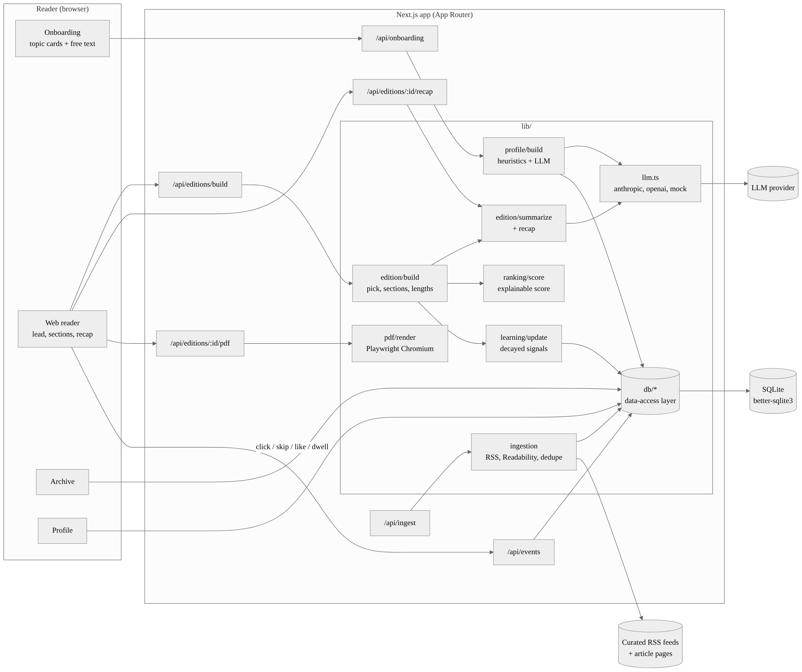

# Personal Morning Paper

A web app that learns what each reader cares about, gathers articles from across the web, and prints one personalized, newspaper-style edition every day. Read it on the web with links to the original articles, download the same edition as a PDF, and browse past editions. Every click, skip, like and minute of reading shapes tomorrow's paper.

Built for NaSCon '26 (Eynvision).



## Features

| Brief requirement | What we built |
|---|---|
| Onboarding with great UX | A five-step flow: your name on the masthead, topic cards (tap once for *interested*, twice for *love it*), free text in your own words, then reading style and time budget. An AI editor turns it into a weighted profile with keywords to watch and things to keep out, and you see the result straight away. |
| Daily newspaper-style PDF | An A4 broadsheet layout rendered with Playwright: masthead, two-column lead story, "3 things you learned" box, then sections in columns. Every PDF is the same edition as the webpage. |
| Personalized content **and** presentation | Lead story = highest score. Section order follows your weights. Story count comes from your time budget. Story length comes from your reading style: the lead runs long, strong sections get longer top stories, weak sections run as briefs. Grid density follows reading style (3 columns for briefs). Your name is on the masthead. |
| Web reading experience | Links to the originals, Skip (with undo), ▲/▼ reactions, a "why this story?" note on every story, section navigation, View/Download PDF, and an archive of past editions. |
| Learning from behaviour | Clicks, skips, likes/dislikes and on-screen reading time (IntersectionObserver) feed topic weights with a 5-day half-life. Each edition shows what changed, and `/profile` shows base vs learned weights. |
| Original features | **"3 things you learned today"**: three concrete facts from the front page, which you can rewrite from what you actually read. **"Why this story"**: a plain-English reason built from the ranking score. **"Off your beat"**: up to two wildcard stories outside your sections, so you discover new things. |

## Quick start

Requires Node.js 20+.

```bash
npm install
npx playwright install chromium   # once, for PDF export
cp .env.example .env.local        # optional: add an LLM key
npm run db:init                   # creates ./data/morning-paper.db
npm run dev                       # http://localhost:3000
```

Then:

1. **Start my paper**: go through onboarding.
2. On the "print" screen choose **Fetch the news & print** (live RSS), or **Use sample stories** if you're offline.
3. Read, skip, like ▲, open originals. Then **Profile → Reprint today's paper with what I've learned** to watch the paper adapt.
4. **Download PDF**, and open **Archive** for past editions.

### Demo script (about 3 minutes)

```bash
npm run ingest -- --sample                      # offline: 42 labelled sample stories
npm run edition:build -- --date 2026-10-16      # optional: put yesterday's paper in the archive
```

1. Onboard as "Ayesha": love *Technology*, like *Climate* and *Business*, write "startups and clean energy, no crypto".
2. Print. Point out the lead story and its "why this story?" note, the crypto story missing because of the avoid list, the "3 things you learned" box, and **Download PDF**.
3. Like the Climate stories and skip the Business ones, then reprint from **Profile**. A banner shows how the weights moved (e.g. *Climate ▲ 60 → 92, Business ▼ 90 → 71*), and the section order and lead change.

## Scripts

| Command | What it does |
|---|---|
| `npm run dev` | Dev server with hot reload |
| `npm run build` / `npm start` | Production build / server |
| `npm run db:init` | Create the SQLite file and run pending migrations |
| `npm run ingest` | Fetch live RSS for followed topics and extract full text (`-- --no-extract` is faster, `-- --sample` works offline) |
| `npm run edition:build` | Build today's edition for every reader, which is what a daily cron runs (`-- --ingest`, `-- --ingest-sample`, `-- --date YYYY-MM-DD`) |
| `npm test` | Data-access layer smoke test plus logic checks (profile parsing, dedupe, scoring, learning, recap) |
| `npm run typecheck` / `npm run lint` | TypeScript and ESLint |

Daily scheduling: point a cron job at `npm run edition:build -- --ingest`, e.g. `0 6 * * *`.

## Environment

See `.env.example`. `.env.local` is git-ignored.

| Variable | Purpose |
|---|---|
| `DATABASE_PATH` | SQLite file (default `./data/morning-paper.db`) |
| `LLM_PROVIDER` | `anthropic`, `openai` or `mock` |
| `LLM_API_KEY` | Provider key (not needed for `mock`) |
| `LLM_MODEL` | Optional model override |

**No key? It still works.** Every LLM call is optional. Without one, the profile comes from keyword matching, summaries are the article's own leading sentences, and the recap picks each story's most fact-dense sentence. If a configured LLM times out or returns invalid JSON, the same fallbacks kick in for that call.

## How it works

```
ingest → dedupe → learn → score → pick → compose → summarize + recap → save → render web / PDF
```

- **Ingestion** (`lib/ingestion`): curated RSS feeds per topic (`lib/topics.ts`). Fetches 4 feeds at a time, keeps items under 72 h old, and extracts full text with Mozilla Readability. Dedupes by canonical URL (tracking params stripped) and by a normalized-title hash. A dead feed is reported and skipped.
- **Learning** (`lib/learning/update.ts`): each story you interacted with in the last 30 days yields a signal (open +0.6, like +1, dislike −1, skip −0.6, reading +0.5/min up to +0.5), multiplied by `0.5^(age/5 days)`. Per topic: `weight = clamp(base + 0.35·tanh(signal/2))`. It is recomputed from your onboarding base each time, so it's bounded and never compounds.
- **Ranking** (`lib/ranking/score.ts`): `0.55·topic weight + 0.25·recency (18 h half-life) + keyword boosts (max 0.4) + text quality`. Anything matching your avoid list is dropped, as is anything already printed, skipped or disliked.
- **Composing** (`lib/edition/build.ts`): a greedy pick that drops near-duplicate headlines, slightly penalizes repeat outlets, and caps each section in proportion to its weight. It adds at most two wildcards. The lead is the top pick.
- **Summaries & recap** (`lib/edition/summarize.ts`, `recap.ts`): the LLM writes them in batches of 6, in parallel, validated with zod, with extractive fallbacks.
- **PDF** (`lib/pdf`): an HTML/CSS print template built from the same `EditionView` as the webpage and rendered by a reused headless Chromium.

More detail, the pipeline sequence and the ER diagram are in **[docs/architecture.md](docs/architecture.md)**.

## Project layout

```
app/                 pages and API routes (App Router)
  onboarding/ paper/ paper/[date]/ archive/ profile/
  api/onboarding  api/ingest  api/events  api/session
  api/editions/build  api/editions/[id]/pdf  api/editions/[id]/recap
components/          UI (onboarding flow, story card, recap box, dwell tracker…)
lib/
  db/                data-access layer: the only code that touches storage
  ingestion/         RSS, Readability extraction, dedupe, offline samples
  profile/           onboarding answers → interest profile
  learning/          events → topic weights
  ranking/           scoring + "why this story"
  edition/           builder, summaries, recap, view model
  pdf/               print template + Playwright renderer
  llm.ts             provider-agnostic JSON LLM calls (anthropic, openai, mock)
scripts/             db:init, ingest, edition:build, tests
docs/                architecture notes and diagrams
```

## Data model

`users`, `interest_profiles` (summary + preferences JSON), `profile_topics` (weight, base weight, source), `articles`, `editions` (one per user per day, with layout + recap JSON), `edition_items` (section, position, lead flag, length, score, summary, why), `events` (click, skip, like, dislike, dwell), `app_meta`. Migrations are versioned with `PRAGMA user_version`.

### Swapping SQLite for Supabase/Postgres

Feature code only imports `db` from `@/lib/db`. Every repository function is `async` and returns plain domain types, so moving to Postgres means re-implementing `lib/db/*` with the same signatures. The schema already uses portable types: UUID text ids, ISO timestamps and JSON text columns. Reader identity is a cookie in `lib/session.ts`; swap it for Supabase Auth without touching the pages.

## Notes

- Sample stories (`npm run ingest -- --sample`) are fictional and labelled **Sample Desk**. They exist so the demo runs without network access.
- Some publishers block scrapers or change feed URLs. Ingestion reports each feed's status, and you can edit the list in `lib/topics.ts`.
