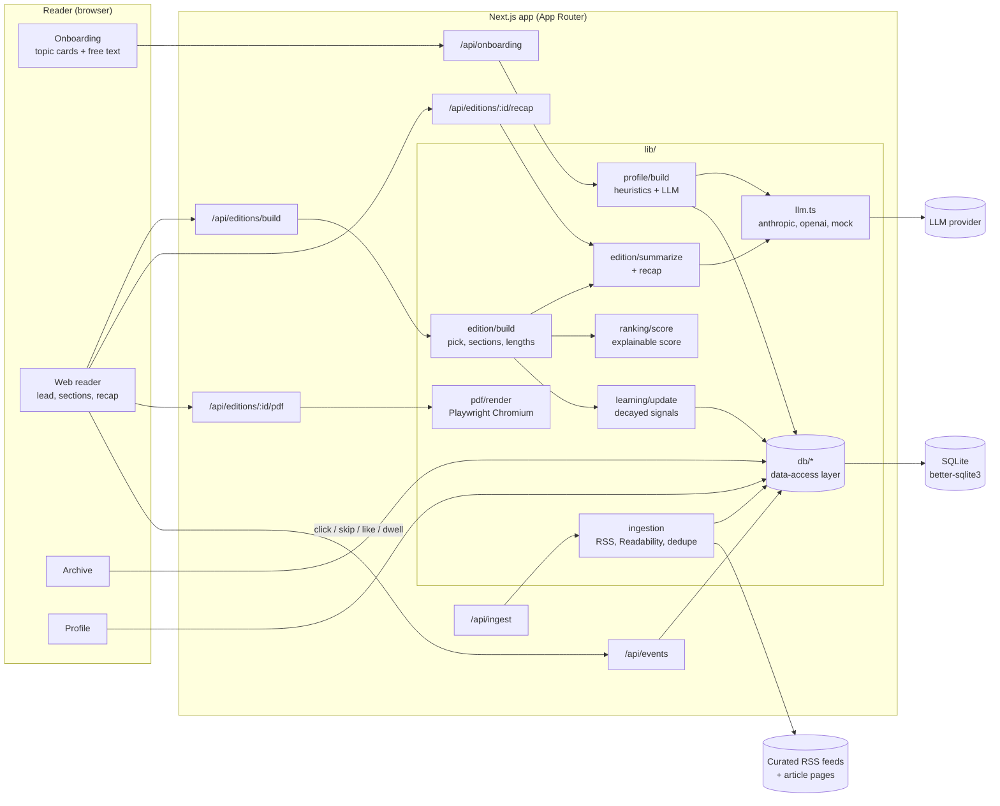
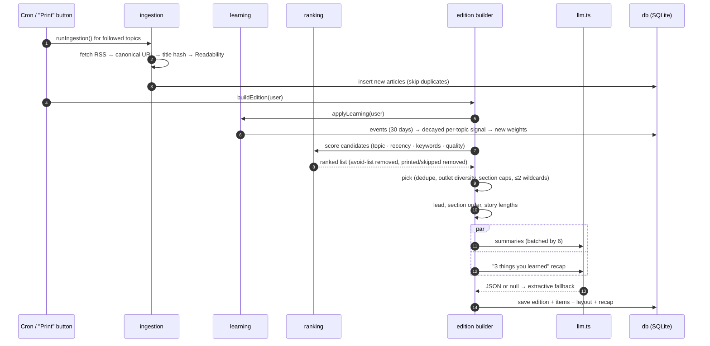
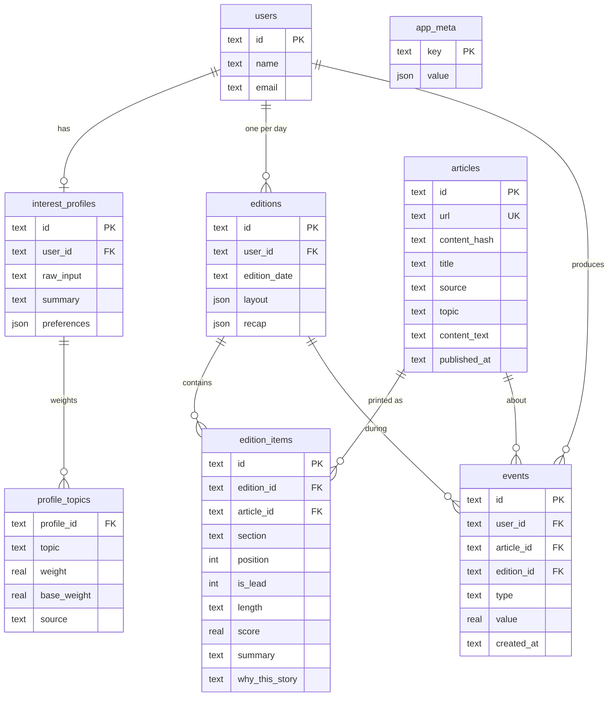

# Architecture

Personal Morning Paper is one Next.js app. Pages, API routes and the daily pipeline all share one data-access layer over SQLite.

## System diagram

## Daily pipeline

## Data model

## Key decisions

| Decision | Why |
|---|---|
| Data-access layer with async functions over synchronous SQLite | Feature code never sees SQL, so a move to Supabase/Postgres only rewrites `lib/db/*`. |
| Explainable score, not an opaque model | The same score parts produce the "why this story" note, so every placement can be explained in one sentence. |
| Learning recomputed from the onboarding base | `weight = base + 0.35·tanh(signal/2)` is bounded and idempotent. One busy morning can't erase what the reader said they like. |
| 5-day half-life on signals | Last week matters more than last month, so interests can drift naturally. |
| LLM is optional everywhere | Each LLM call validates its JSON with zod and returns `null` on any failure. Every caller has a deterministic fallback: a keyword profile, extractive summaries, key-fact recaps. |
| Same `EditionView` for web and PDF | The PDF is guaranteed to be the same edition as the webpage. |
| Reused headless Chromium | Launching takes about 1 s and rendering about 0.2 s, so the browser is kept warm between PDF requests. |
| Offline sample stories | The demo works without network access, and the stories are clearly labelled "Sample Desk". |
